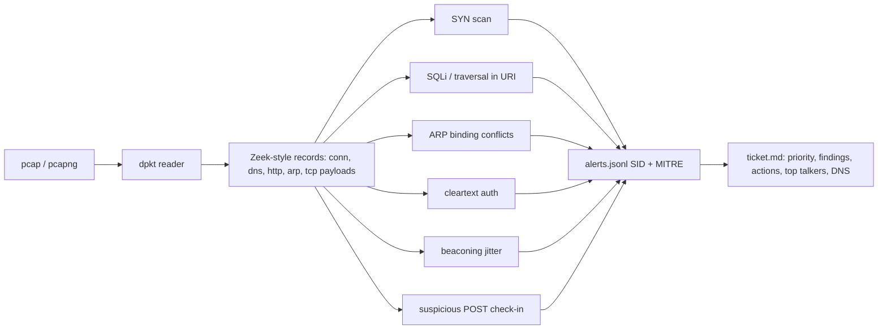

# pcap-hunter: PCAP to Zeek-style logs to Suricata-style alerts to an incident ticket

> **Lab project.** Runs on **public sample PCAPs** that are fetched by `samples/fetch.sh` and not committed. Unit tests build synthetic PCAPs in memory, so CI doesn't need the downloads.

## Problem
An L1/L2 analyst who gets a PCAP from an IDS alert or a user report has to answer three questions fast: *what happened, how bad is it, what do I do?* Running Zeek and Suricata and then writing the ticket by hand is slow. pcap-hunter does the first pass in pure Python (dpkt). It builds conn/dns/http/arp records the way Zeek does, applies 7 Suricata-inspired signatures mapped to MITRE, and writes a **prioritised markdown ticket with recommended actions**.

## Architecture


## Run
```bash
pip install -r requirements-dev.txt
pytest -q                                   # 6 tests, synthetic pcaps
sh samples/fetch.sh                         # downloads public samples + writes SHA256SUMS.txt
python -m pcaphunter.cli samples/*.pcap* samples/*.cap -o results
docker build -t pcap-hunter . && docker run --rm -v $PWD/samples:/pcaps pcap-hunter /pcaps/synscan.pcapng -o /pcaps/out
```

## Results (actual run, 2026-10-11): `results/`
| PCAP (source) | Ground truth (from the sample's name/description) | pcap-hunter verdict | Correct? |
|---|---|---|---|
| synscan.pcapng (Sanders) | SYN port scan | P3, SYN scan, 1994 conns | yes |
| http_dvwa_sqlinjection.pcapng (Sanders) | SQLi against DVWA | P2, SQLi x3 | yes |
| http_dvwa_directorytraversal.pcapng (Sanders) | traversal against DVWA | P2, traversal | yes |
| arppoison.pcapng (Sanders) | ARP cache poisoning | P3, one MAC claims 172.16.0.1 *and* .105 | yes (after fix, see below) |
| cryptowall4_c2.pcapng (Sanders) | CryptoWall 4 C2 | P3, 3 POSTs to `/<rand>.php?n=` with no User-Agent | yes |
| telnet-raw.pcap (Wireshark wiki) | cleartext telnet login | P3, cleartext auth :23 | yes |
| smtp.pcap (Wireshark wiki) | SMTP with AUTH LOGIN | P3, cleartext auth :25 | yes (policy finding) |
| dns.cap (Wireshark wiki) | benign DNS | P5, no findings | yes (negative control) |

8 of 8 were classified as expected. **Bug found during the run:** my first version only read ARP *replies*. The poisoning in `arppoison.pcapng` is advertised through a request, so the first run missed it (P5). I now read sender bindings from both ops, and the sample is detected.

SHA-256 of every sample is in `samples/SHA256SUMS.txt`.

## Limitations
- This is **not** Zeek or Suricata. It has 7 hand-written heuristics, no stream reassembly (only the first 4 KB of each segment is kept) and no TLS/JA3. Encrypted C2 would be missed unless it beacons regularly.
- The beaconing rule is tested only on synthetic data. None of the public samples here are long enough to show periodicity.
- The "one MAC, many IPs" ARP rule false-positives on routers doing proxy ARP. That's why it's medium severity.
- The eval is 8 samples whose labels come from their file names. It's a smoke test, not a benchmark.
- The Docker image was not built yet (no Docker daemon).

## Sources
- Chris Sanders, *packets* (Practical Packet Analysis captures), cited as the author requests: https://github.com/chrissanders/packets
- Wireshark SampleCaptures: https://wiki.wireshark.org/SampleCaptures
- Zeek conn.log fields/states: https://docs.zeek.org/en/master/logs/conn.html
- Suricata rule format (SID/msg conventions): https://docs.suricata.io/en/latest/rules/intro.html
- dpkt: https://github.com/kbandla/dpkt
- MITRE ATT&CK T1046, T1190, T1557.002, T1040, T1071.001
